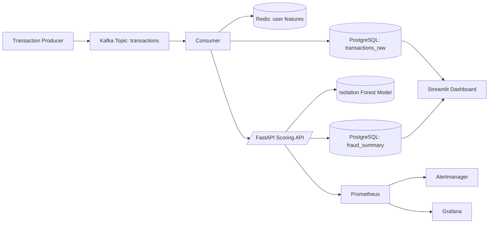

# Real-Time Fraud Detection Pipeline

An end-to-end fraud analytics platform for streaming transaction ingestion, online feature aggregation, anomaly scoring, API serving, and operational monitoring.

The repository combines:
- Event streaming (Kafka + Avro + Schema Registry)
- Feature serving (Redis)
- Operational storage and analytics (PostgreSQL)
- Online model scoring API (FastAPI)
- Monitoring and alerting (Prometheus, Alertmanager, Grafana)
- Optional dashboarding (Streamlit)

## Table of Contents

- [1. Overview](#1-overview)
- [2. Architecture](#2-architecture)
- [3. Repository Structure](#3-repository-structure)
- [4. Data Contract](#4-data-contract)
- [5. Prerequisites](#5-prerequisites)
- [6. Quick Start with Docker Compose](#6-quick-start-with-docker-compose)
- [7. Local Development (Without Compose)](#7-local-development-without-compose)
- [8. API Reference](#8-api-reference)
- [9. Monitoring and Alerting](#9-monitoring-and-alerting)
- [10. Model Training and Evaluation](#10-model-training-and-evaluation)
- [11. Testing and Quality](#11-testing-and-quality)
- [12. Operations Scripts](#12-operations-scripts)
- [13. Troubleshooting](#13-troubleshooting)
- [14. Security and Hardening Notes](#14-security-and-hardening-notes)

## 1. Overview

This project demonstrates a practical real-time fraud workflow:

1. Producers generate transactions and publish to Kafka using Avro serialization.
2. Consumers process events, write raw records to PostgreSQL, and maintain user-level features in Redis.
3. The scoring API loads a trained model and serves anomaly predictions from Redis-backed features.
4. Results are persisted in `fraud_summary` for downstream analytics.
5. Prometheus scrapes metrics from FastAPI and triggers alerts through Alertmanager.

## 2. Architecture



Core services are orchestrated in `docker-compose.yml`.

## 3. Repository Structure

High-value files and directories:

- `serve_model.py`: FastAPI scoring and explainability endpoints.
- `consumer.py`: Avro consumer, Redis feature updates, SQL upserts.
- `producer.py`: Avro transaction producer and raw SQL insert.
- `feature_store.py`: Kafka-to-Redis feature aggregator (alternative flow).
- `app.py`: Streamlit analytics dashboard.
- `metrics.py`: Prometheus counters.
- `sql/schema.sql`: PostgreSQL schema bootstrap.
- `schemas/transactions.avsc`: Avro schema contract.
- `prometheus/` and `alertmanager/`: observability configuration.
- `models/`: model training and evaluation scripts.
- `tests/`: API and consumer test coverage.

## 4. Data Contract

Avro schema (`schemas/transactions.avsc`) for topic `transactions`:

```json
{
  "namespace": "com.example.fraud",
  "type": "record",
  "name": "Transaction",
  "fields": [
	 {"name": "transaction_id", "type": "int"},
	 {"name": "user_id",        "type": "int"},
	 {"name": "amount",         "type": "double"},
	 {"name": "timestamp",      "type": "long"},
	 {"name": "country",        "type": "string"}
  ]
}
```

PostgreSQL tables (`sql/schema.sql`):
- `transactions_raw`: immutable ingested transactions
- `fraud_summary`: user-level aggregate features + anomaly decision

## 5. Prerequisites

For containerized execution:
- Docker
- Docker Compose v2+

For local Python execution:
- Python 3.10+
- Redis
- PostgreSQL 15+
- Kafka + Zookeeper + Schema Registry

Optional:
- LM Studio endpoint for `/explain`

## 6. Quick Start with Docker Compose

### 6.1 Configure environment

Create `.env` in repository root (used by the `api` service):

```env
MODEL_PATH=fraud_isolation_forest.joblib
REDIS_HOST=redis
REDIS_PORT=6379
POSTGRES_HOST=postgres
POSTGRES_PORT=5432
POSTGRES_DB=fraud_db
POSTGRES_USER=postgres
POSTGRES_PASSWORD=password
LMSTUDIO_URL=http://host.docker.internal:1234/v1/generate
LMSTUDIO_MODEL=mistral-7b
```

### 6.2 Start platform

```bash
docker compose up -d --build
```

Services exposed by default:
- FastAPI: http://localhost:8000
- Swagger UI: http://localhost:8000/docs
- Prometheus: http://localhost:9090
- Alertmanager: http://localhost:9093
- Grafana: http://localhost:3000
- Schema Registry: http://localhost:8081

### 6.3 Produce and consume events

Run these from the project root (host shell):

```bash
python producer.py
```

```bash
python consumer.py
```

If running producer/consumer inside containers, ensure hostnames match container networking (for example `kafka`, `schema-registry`, `postgres`, `redis`).

### 6.4 Validate end-to-end

Call the API:

```bash
curl "http://localhost:8000/predict?user_id=101"
```

If features exist for `user:101` in Redis, response includes:
- `user_id`
- `anomaly_score`
- `is_fraud`

## 7. Local Development (Without Compose)

### 7.1 Create virtual environment

```bash
python -m venv .venv
source .venv/bin/activate  # Linux/macOS
.venv\Scripts\activate     # Windows PowerShell
```

### 7.2 Install dependencies

Minimal API/runtime:

```bash
pip install -r requirements_api.txt
```

Full stack/training dependencies:

```bash
pip install -r requirements.txt
```

Developer tools:

```bash
pip install -r requirements_dev.txt
```

### 7.3 Run scoring API

```bash
uvicorn serve_model:app --host 0.0.0.0 --port 8000 --reload
```

### 7.4 Run dashboard

```bash
streamlit run app.py
```

## 8. API Reference

Base URL: `http://localhost:8000`

### 8.1 GET /predict

Scores a user from Redis feature hash `user:{user_id}`.

Query params:
- `user_id` (int, required)

Example:

```bash
curl "http://localhost:8000/predict?user_id=123"
```

### 8.2 GET /explain

Returns prediction plus model explanation text. Uses LM Studio endpoint if available, otherwise falls back to deterministic explanation.

Example:

```bash
curl "http://localhost:8000/explain?user_id=123"
```

### 8.3 GET /fraud-by-country

Aggregates fraudulent users by transaction country from SQL tables.

### 8.4 GET /top-risk-users

Returns users ordered by most anomalous score.

Query params:
- `limit` (int, optional, default 10)

## 9. Monitoring and Alerting

### 9.1 Metrics

Prometheus counters in `metrics.py`:
- `fraud_summary_total_transactions`
- `fraud_summary_is_fraud_total`

FastAPI metrics are exposed on `/metrics` using `prometheus-fastapi-instrumentator`.

### 9.2 Prometheus

Configured in `prometheus/prometheus.yml` with:
- scrape job for `api:8000`
- alert rules loaded from `prometheus/rules.yml`

### 9.3 Alert Rules

Current rules include:
- high `/predict` traffic
- high fraud-rate threshold

### 9.4 Grafana

Open http://localhost:3000 and add Prometheus (`http://prometheus:9090`) as data source.

## 10. Model Training and Evaluation

Current repository includes three modeling tracks:

1. Isolation Forest (active serving model)
2. XGBoost (supervised classifier using pseudo-labels)
3. Autoencoder (reconstruction-error anomaly detector)

### 10.1 Generate user-level features

```bash
python extract_features.py
```

Creates `user_features.csv` from Redis hashes.

### 10.2 Train Isolation Forest

```bash
python models/isolation_forest/train.py
python models/isolation_forest/eval.py
```

Artifact used by API:
- `fraud_isolation_forest.joblib` (root-level expected default)

### 10.3 Train XGBoost

```bash
python models/xgboost/train_xgb.py
python models/xgboost/eval_xgb.py
```

### 10.4 Train Autoencoder

```bash
python models/auto_encoder/train_ae.py
python models/auto_encoder/eval_ae.py
```

## 11. Testing and Quality

Run tests:

```bash
pytest -q
```

Run coverage:

```bash
pytest --cov=. --cov-report=term-missing
```

Lint:

```bash
flake8 .
```

Configuration:
- `pytest.ini`
- `setup.cfg`

## 12. Operations Scripts

Repository includes utility scripts:

- `backup_fraud_summary.sh`: exports `fraud_summary` to CSV in `backups/`
- `etl_cleanup.sh`: rotates logs and purges/recreates Kafka topic
- `cleanup_logs.sh`: removes files under `./logs/`

Run with:

```bash
bash backup_fraud_summary.sh
bash etl_cleanup.sh
bash cleanup_logs.sh
```

## 13. Troubleshooting

Common issues and checks:

1. `/predict` returns 404 for user
	- Redis key `user:{id}` does not exist.
	- Verify consumer/feature updater is running and writing `count` + `avg_amount`.

2. API cannot connect to PostgreSQL
	- Validate `POSTGRES_*` environment variables.
	- Confirm DB readiness and schema initialization from `sql/schema.sql`.

3. Kafka connectivity issues on Windows host
	- Use `localhost:29092` from host processes.
	- Use `kafka:9092` from Docker-internal services.

4. Explain endpoint fallback responses
	- LM Studio endpoint may be unreachable or return non-expected payload shape.
	- Confirm `LMSTUDIO_URL` and model availability.

## 14. Security and Hardening Notes

- Do not commit real credentials into repository files.
- Move Alertmanager SMTP credentials to environment variables or secret manager.
- Replace default DB credentials for non-local environments.
- Add TLS, auth, and network policy before deploying beyond local/POC use.
- Add request rate limits and API auth for public-facing deployments.

## License

See `LICENSE`.
